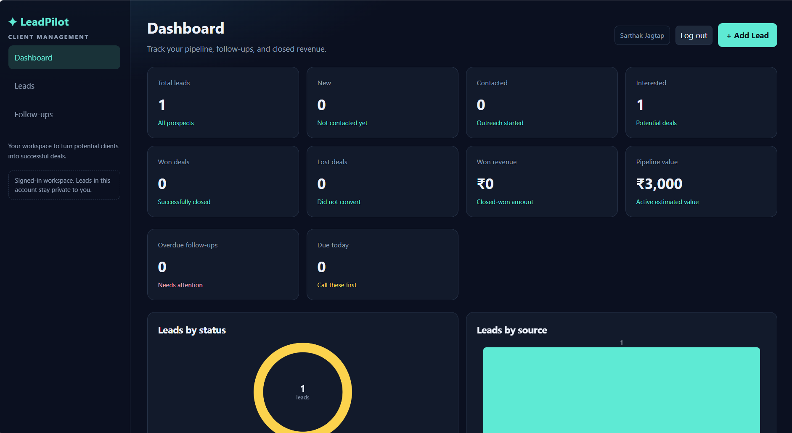
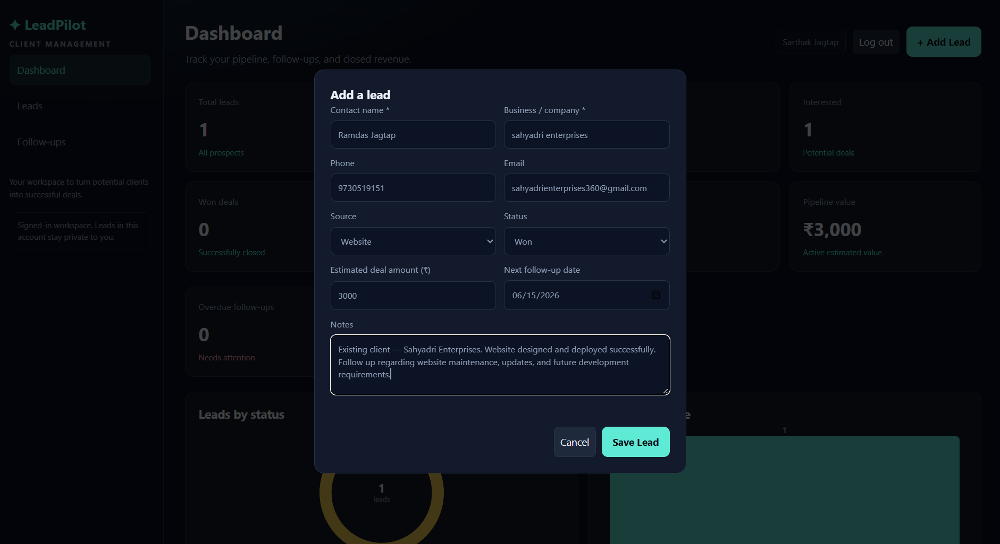

# LeadPilot

A local CRM for freelancers and small businesses. Track leads, follow-ups, and won revenue with a Node.js/Express API and PostgreSQL.

Every account is private: LeadPilot uses **session-based authentication**, and every lead query is scoped to the signed-in user, so one account can never read or change another account's leads.

## Features

- Sign up, sign in, sign out with bcrypt-hashed passwords
- Server-side sessions stored in PostgreSQL (`connect-pg-simple`)
- CSRF protection on every state-changing API request
- Per-user leads: list, create, read, update, delete
- Dashboard statistics (totals, won revenue, pipeline value, overdue/today follow-ups)
- Status and source charts, rendered with the Canvas API (no chart library)
- Search, status/source/follow-up filters, and sortable columns
- Follow-up view grouped into Overdue / Today / Upcoming


## 📸 Screenshots

### Dashboard


### Leads Management


## What you need

- Node.js 20 or newer (the test suite uses the built-in `node --test` runner)
- PostgreSQL 13 or newer (`gen_random_uuid()` is used; developed against PostgreSQL 18.x)
- A database named `leadpilot`

## One-time setup

1. Go to the project folder and install dependencies:

```bash
npm install
```

2. Create your environment file. **Never commit this file** — `.gitignore` already excludes `.env`.

```bash
cp .env.example .env
```

3. Generate a unique session secret and put it in `.env` (at least 32 characters):

```bash
node -e "console.log(require('crypto').randomBytes(48).toString('hex'))"
```

4. Create the database (skip if it already exists). The app creates/updates its tables on startup and **never** runs `DROP TABLE` or `TRUNCATE`:

```sql
CREATE DATABASE leadpilot;
```

5. Fill in `.env` with your own PostgreSQL settings. Do not invent or share credentials.

## Environment variables

| Variable | Required | Default | Purpose |
| --- | --- | --- | --- |
| `SESSION_SECRET` | **yes** | – | Signs the session cookie. Must be at least 32 characters. The server refuses to start without it. |
| `PORT` | no | `3000` | HTTP port. |
| `NODE_ENV` | no | `development` | Set to `production` to force secure cookies. |
| `SESSION_DAYS` | no | `7` | Session lifetime in days. |
| `BCRYPT_ROUNDS` | no | `12` | bcrypt cost factor (minimum 4). |
| `COOKIE_SECURE` | no | `false` | Set to `true` when serving over HTTPS. |
| `PGHOST` | no | `localhost` | PostgreSQL host. |
| `PGPORT` | no | `5432` | PostgreSQL port. |
| `PGUSER` | no | `postgres` | PostgreSQL user. |
| `PGPASSWORD` | no | – | PostgreSQL password. Required when your server uses SCRAM/MD5 auth. |
| `PGDATABASE` | no | `leadpilot` | Database name. |
| `DATABASE_URL` | no | – | Optional single connection URL. When set it takes precedence over the individual `PG*` values. |

## Run the app

```bash
npm start     # production-style
npm run dev   # auto-restart with nodemon
```

Open [http://localhost:3000](http://localhost:3000). Guests are redirected to `/login`; create an account at `/signup` first.

On startup the server prints the exact PostgreSQL target it connected to, for example `Connected to PostgreSQL (localhost:5432/leadpilot as user "postgres")`. If it cannot connect, it exits with an actionable message and never prints your password.

## Authentication and data ownership

- Passwords are hashed with bcrypt and never stored or returned in plain text.
- Sessions live in the `user_sessions` table; the cookie is `httpOnly`, `SameSite=Lax`, and signed with `SESSION_SECRET`.
- The session id is regenerated on sign-up and sign-in, so a pre-login cookie can never be reused.
- Sign-in and sign-up are rate limited (10 attempts per 15 minutes per IP).
- Every state-changing `/api` request needs the CSRF token from `GET /api/auth/csrf`, sent in the `x-csrf-token` header. A missing or wrong token returns `403` with `{"code":"csrf"}`.
- Every lead query is scoped by `user_id` (`buildListQuery` throws if it is not given a valid authenticated user id), and requireAuth rejects any session whose user id is not a real UUID.
- Leads with `user_id IS NULL` (for example from the old single-user version) are **kept in PostgreSQL but never shown to any account, and LeadPilot never assigns them automatically**. The server logs a warning with the count on startup. To inspect them, run:

```bash
node scripts/count-unowned-leads.js   # read-only: prints lead columns and counts
```

Assigning ownership of those legacy rows is a deliberate manual decision. Do **not** write an automatic backfill — decide the owner yourself and update the rows explicitly (for example with `UPDATE leads SET user_id = '<uuid>' WHERE id = '<uuid>';`).

## Tests

```bash
npm test
```

This runs the Node.js built-in test runner over:

| File | Covers |
| --- | --- |
| `tests/validate.test.js` | Lead payload validation, UUID checks, filter parsing, `LIKE` escaping |
| `tests/leadsQuery.test.js` | SQL builder scoping and parameters, including rejecting a missing owner |
| `tests/api.test.js` | API behavior: auth required, CSRF, stats, CRUD, search/filters, cross-user isolation, unowned leads stay hidden |
| `tests/auth.test.js` | Sign up, sign in, sign out, session regeneration, password hashing, page redirects |

The tests use an in-memory pool and a memory session store, so **no PostgreSQL server is required** and no real database is touched.

### Optional: end-to-end check against a real PostgreSQL server

`scripts/verify-e2e.js` starts a throwaway PostgreSQL cluster in your OS temp folder (its own port and data directory), runs `node server.js` against it, and then exercises the full flow over HTTP: CSRF, sign-up, sign-in, per-user lead isolation, stats, search/filters, logout, and the unowned-lead warning. It never touches your `.env` or your real `leadpilot` database, and it never drops or truncates anything.

```bash
npm install --no-save embedded-postgres   # optional helper, not a project dependency
node scripts/verify-e2e.js
```

## REST API

| Method | Path | Auth | CSRF | Purpose |
| --- | --- | --- | --- | --- |
| GET | `/api/health` | public | no | App health (no secrets) |
| GET | `/api/auth/csrf` | public | no | Issue (or return) this session's CSRF token |
| POST | `/api/auth/register` | public | yes | Create an account and sign in |
| POST | `/api/auth/login` | public | yes | Sign in |
| POST | `/api/auth/logout` | session | yes | Sign out and destroy the session |
| GET | `/api/auth/me` | session | no | Current user |
| GET | `/api/stats` | session | no | Dashboard totals and chart data for your leads |
| GET | `/api/leads` | session | no | Your leads (`search`, `status`, `source`, `followup`, `sort`, `order`) |
| GET | `/api/leads/:id` | session | no | One of your leads |
| POST | `/api/leads` | session | yes | Create a lead |
| PUT | `/api/leads/:id` | session | yes | Full update of your lead |
| DELETE | `/api/leads/:id` | session | yes | Delete your lead |

Lead fields: `name`, `business`, `phone`, `email`, `source`, `status`, `amount`, `notes`, `followup_date`, `created_at`, `updated_at`.

Statuses: `New`, `Contacted`, `Interested`, `Won`, `Lost`.

Sources: `Website`, `Referral`, `LinkedIn`, `Instagram`, `Cold Call`, `Email`, `Other`.

Sort fields: `created_at`, `followup_date`, `amount`, `name`, `status`, `business`.

### Calling the API by hand

Sign in with curl using a cookie jar, then reuse the CSRF token:

```bash
curl -s -c jar.txt http://localhost:3000/api/auth/csrf
TOKEN=$(curl -s -b jar.txt -c jar.txt http://localhost:3000/api/auth/csrf | node -pe "JSON.parse(require('fs').readFileSync(0,'utf8')).token")
curl -s -b jar.txt -c jar.txt -H 'content-type: application/json' -H "x-csrf-token: $TOKEN" \
  -d '{"name":"Sarthak","email":"me@example.com","password":"password123"}' \
  http://localhost:3000/api/auth/register
curl -s -b jar.txt http://localhost:3000/api/leads
```

## How to try each feature

1. **Sign up / sign in** — open `/signup`, create an account, and you land on the dashboard. Open `/login` in a private window and sign in as a second account.
2. **Isolation** — add a lead in the first account. Reload the second account: it sees none of it. Try opening the first account's lead id directly (`/api/leads/<id>`) while signed in as the second account: `404`.
3. **Dashboard stats** — add leads with statuses New, Contacted, Interested, Won, and Lost. Won revenue includes only Won amounts; pipeline value excludes Won and Lost.
4. **Charts** — the status and source charts update from `/api/stats` with no extra libraries.
5. **Add lead** — **Add Lead**. Name and business are required.
6. **View / edit** — **View** or **Edit** to change status, amount, notes, or follow-up date.
7. **Search and filters** — on **Leads**, search by name/business/email/phone/notes, filter by status, source, and follow-up, and click column headers to sort.
8. **Follow-ups** — create leads with yesterday's, today's, and a future date; open **Follow-ups** to see them grouped, with overdue rows highlighted.
9. **Delete** — **Delete**, confirm, and verify the row is gone after refresh.
10. **Persistence** — restart the server (`Ctrl+C`, then `npm start`). Data is read from PostgreSQL, not the browser.
11. **Log out** — **Log out** clears the session and returns you to `/login`.

## Troubleshooting

| Message on startup | What to do |
| --- | --- |
| `SESSION_SECRET is missing or shorter than 32 characters` | Add a 32+ character `SESSION_SECRET` to `.env`. |
| `PostgreSQL authentication failed for ...` | Set `PGPASSWORD` in `.env` to your PostgreSQL user's password. |
| `The database "leadpilot" was not found` | Create it: `CREATE DATABASE leadpilot;` |
| `Could not reach PostgreSQL at ...` | Start the PostgreSQL service (for example the Windows service `postgresql-x64-18`). |
| `N lead(s) have no owner (user_id IS NULL)` | Legacy rows from the single-user version. They are hidden from every account and are never auto-assigned. Decide the owner manually (see above). |
| `403` with `code: "csrf"` in the UI | Your session token expired. Refresh the page; the frontend requests a new token automatically. |

## Security notes

- Secrets live only in `.env`, which is gitignored. Never commit `.env`, passwords, or session secrets.
- All SQL is parameterized; every lead query is owner-scoped.
- Helmet sets security headers and a strict Content-Security-Policy.
- Session cookies are `httpOnly` + `SameSite=Lax` (and `Secure` when `COOKIE_SECURE=true`).
- Database initialization is additive only: `CREATE TABLE IF NOT EXISTS`, `ADD COLUMN IF NOT EXISTS`, `CREATE INDEX IF NOT EXISTS`.
- This app is meant to run locally or behind HTTPS. Do not expose it to the public internet without HTTPS (`COOKIE_SECURE=true`) and a trusted proxy.

## Project layout

- `server.js` — loads config, verifies the PostgreSQL connection, initializes the schema, starts the HTTP server
- `src/config.js` — environment configuration
- `src/db.js` — PostgreSQL pool and error mapping
- `src/initDb.js` — additive schema initialization (never destructive)
- `src/session.js` — PostgreSQL session store and cookie settings
- `src/csrf.js` — CSRF token generation and validation
- `src/authRoutes.js` — register, login, logout, `me`, `csrf`
- `src/authValidate.js`, `src/passwords.js` — auth input validation and bcrypt helpers
- `src/routes.js`, `src/leadsQuery.js`, `src/validate.js` — owner-scoped lead CRUD, stats, and query building
- `src/app.js` — Express app, Helmet/CSP, sessions, CSRF, page routes
- `public/` — dashboard, login/signup pages, CSS, browser JavaScript
- `tests/` — Node.js built-in test runner suites
- `scripts/count-unowned-leads.js` — read-only inventory of leads and unowned counts
